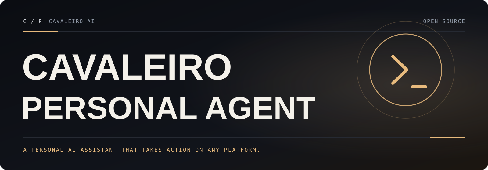

[English](README.md) · **Português (Brasil)**

<a id="top"></a>

<p align="center">
  
</p>

# Cavaleiro Personal Agent

**A IA que realmente faz as coisas. Qualquer sistema. Qualquer plataforma.**

O Cavaleiro Personal Agent é um assistente pessoal de IA que roda no seu próprio computador e encontra você nos apps de mensagem que você já usa: Discord, iMessage, Slack, Teams, Telegram, WhatsApp e mais de 20 outros, além de uma Control UI na web, uma interface de terminal e apps complementares. Ele mantém a arquitetura, os comandos, a configuração e o ecossistema de plugins do projeto em que se baseia; esta distribuição acrescenta correções de bugs verificadas, um guia em português, um relatório de engenharia e automação segura para fork.

<p align="center">
  <a href="https://github.com/cavaleiro-ai/cavaleiro-personal-agent/actions/workflows/cavaleiro-ci.yml"></a>
  &nbsp;
  <a href="LICENSE"></a>
  &nbsp;
  <a href="CHANGELOG.md"><strong>Changelog</strong></a>
  &nbsp;·&nbsp;
  <a href="docs/cavaleiro/ENGINEERING.md"><strong>Relatório de engenharia</strong></a>
  &nbsp;·&nbsp;
  <a href="docs/cavaleiro/GUIA-PT-BR.md"><strong>Guia completo em português</strong></a>
</p>

**Seu, sem pegadinha.** Estado, memória e credenciais ficam no seu hardware. Modelos e harnesses de agente (Claude, Codex, modelos locais) são plugins que você troca sem mudar mais nada. Seus prompts vão para o provedor de modelo e as plataformas de chat que você configurar. Veja em [Compatibilidade](#compatibilidade) a única requisição que o código herdado faz por padrão (uma verificação diária de atualização) e como desligá-la.

**Nesta página:** [Instalação](#instalação) · [Início rápido](#início-rápido) · [Como as peças se encaixam](#como-as-peças-se-encaixam) · [Segurança](#segurança) · [Documentação](#documentação) · [Desenvolvimento](#desenvolvimento) · [O que o Cavaleiro Personal Agent acrescenta](#o-que-o-cavaleiro-personal-agent-acrescenta) · [Compatibilidade](#compatibilidade) · [Licença](#licença)

## Instalação

Esta distribuição é instalada **a partir do código-fonte**. Ela não publica pacote npm, imagem Docker, script de instalação nem builds de desktop ou celular próprios; os instaladores e pacotes que você encontrar por aí são do projeto original (veja [Compatibilidade](#compatibilidade)).

Requisitos:

- **Node.js 24.16+ (LTS) ou 26.1+** (26 recomendado). Node 22, 23 e 25 não são suportados.
- **pnpm 12.11.1**, a versão fixada no `package.json`. O jeito mais simples de obtê-lo sem instalação global é o Corepack, que vem com o Node 24: `corepack pnpm --version`.
- **Git** e, no Windows, PowerShell ou Git Bash. O WSL2 também funciona.

```bash
git clone --depth 1 https://github.com/cavaleiro-ai/cavaleiro-personal-agent.git
cd cavaleiro-personal-agent
corepack pnpm install --frozen-lockfile
corepack pnpm build
corepack pnpm ui:build
```

`npm install` simples na raiz não é suportado: o repositório é um workspace pnpm com cerca de 180 pacotes de plugins em `extensions/`. A instalação completa leva alguns minutos e alguns gigabytes de disco. No Windows, clone com `git -c core.longpaths=true clone --depth 1 ...` por causa dos caminhos longos.

Prefere não instalar Node e pnpm globalmente? Baixe o zip/tarball do Node.js para uma pasta sua, coloque essa pasta no início do `PATH` apenas no terminal atual e rode `corepack enable --install-directory <pasta> pnpm`. O [guia em português](docs/cavaleiro/GUIA-PT-BR.md#instalação-passo-a-passo) mostra o passo a passo no Windows, no macOS e no Linux.

## Início rápido

Na raiz do repositório, rode a CLI pelo pnpm (o comando continua sendo `openclaw`):

```bash
corepack pnpm openclaw onboard --install-daemon
```

Depois do onboarding:

```bash
corepack pnpm openclaw gateway status
corepack pnpm openclaw dashboard
```

O onboarding verifica o acesso ao modelo, cria o workspace (`~/.openclaw/workspace`), grava a configuração (`~/.openclaw/openclaw.json`) e configura o Gateway. O último comando abre a Control UI; envie uma mensagem para confirmar que o assistente está funcionando. Para rodar o Gateway em primeiro plano em vez de como serviço, use `node openclaw.mjs gateway --port 18789 --verbose` depois do `pnpm build`.

O [guia de primeiros passos](docs/start/getting-started.md) herdado (em inglês) cobre a configuração de canais e a solução de problemas em detalhe; todos os comandos de lá funcionam igual nesta distribuição quando prefixados com `corepack pnpm` num checkout do código-fonte.

## Como as peças se encaixam

```text
 Apps de chat (WhatsApp, Telegram, Slack, Discord, ...)    Control UI · CLI · TUI · apps complementares
                 │  plugins de canal                                   │  WebSocket (127.0.0.1:18789)
                 ▼                                                     ▼
        ┌──────────────────────────────── Gateway ─────────────────────────────────┐
        │ sessões e roteamento · auto-reply · cron · aprovações · estado SQLite    │
        │ host de plugins (provedores, canais, ferramentas, memória, skills)       │
        │ runtime do agente (src/agents) ──► provedores de modelo (src/llm, ...)   │
        └───────────────────────────────────────────────────────────────────────────┘
                 │  ferramentas: shell, arquivos, navegador, web, nós (câmera, tela, ...)
                 ▼
          sua máquina, sandboxes e dispositivos pareados
```

- O [Gateway](docs/gateway/index.md) é o plano de controle local de sessões, ferramentas, eventos e conexões de canais.
- A [Control UI](docs/web/control-ui.md), a CLI e a [TUI](docs/web/tui.md) se conectam ao Gateway.
- Os [canais](docs/channels/index.md) levam o assistente ao WhatsApp, Telegram, Slack, Discord, Google Chat, Signal, iMessage e outros serviços.
- [Apps complementares e nós](docs/platforms/index.md) acrescentam voz, Canvas, câmera, tela e ações locais nas plataformas suportadas.

Funciona com [provedores de modelo](docs/concepts/model-providers.md) hospedados e locais. [Ferramentas](docs/tools/index.md), [skills](docs/tools/skills.md) e [plugins](docs/tools/plugin.md) ampliam o que o assistente consegue fazer. O [guia em português](docs/cavaleiro/GUIA-PT-BR.md#arquitetura) e o [relatório de engenharia](docs/cavaleiro/ENGINEERING.md#architecture-map) têm um mapa da arquitetura no nível do código.

## Segurança

Trate mensagens recebidas como entrada não confiável. Canais que aceitam mensagens diretas pareiam remetentes desconhecidos por padrão; aprove um pedido com `openclaw pairing approve <canal> <código>`.

As ferramentas rodam no host para a sessão principal, a menos que você configure sandbox. Leia o [guia de segurança](docs/gateway/security/index.md), o [runbook de exposição](docs/gateway/security/exposure-runbook.md) e o [guia de sandbox](docs/gateway/sandboxing.md) antes de conectar outras pessoas ou expor o Gateway remotamente. Relate bugs nos [issues do GitHub](https://github.com/cavaleiro-ai/cavaleiro-personal-agent/issues) e vulnerabilidades de forma privada, como descrito em [SECURITY.md](SECURITY.md).

## Documentação

A pasta `docs/` é a documentação técnica herdada (em inglês), com o produto renomeado para Cavaleiro Personal Agent no texto. Ela descreve este código com precisão; só instaladores, canais de release e serviços hospedados são diferentes, como listado em [Compatibilidade](#compatibilidade).

| Objetivo                               | Comece aqui                                                                                                                                                                        |
| -------------------------------------- | ---------------------------------------------------------------------------------------------------------------------------------------------------------------------------------- |
| Entender esta distribuição             | [Guia em português](docs/cavaleiro/GUIA-PT-BR.md) · [Relatório de engenharia](docs/cavaleiro/ENGINEERING.md) · [Changelog](CHANGELOG.md)                                           |
| Configurar modelos e autenticação      | [Modelos](docs/concepts/models.md) · [Provedores de modelo](docs/concepts/model-providers.md)                                                                                      |
| Conectar um serviço de mensagens       | [Canais](docs/channels/index.md)                                                                                                                                                   |
| Adicionar ferramentas, skills, plugins | [Ferramentas](docs/tools/index.md) · [Skills](docs/tools/skills.md) · [Plugins](docs/tools/plugin.md)                                                                              |
| Rodar apps e nós de dispositivo        | [Plataformas](docs/platforms/index.md) · [Nós](docs/nodes/index.md)                                                                                                                |
| Usar a CLI e os comandos de chat       | [Referência da CLI](docs/cli/index.md) · [Comandos de barra](docs/tools/slash-commands.md)                                                                                         |
| Configurar ou operar o Gateway         | [Configuração](docs/gateway/configuration.md) · [Arquitetura](docs/concepts/architecture.md) · [Setup do código-fonte](docs/start/setup.md) · [Windows](docs/platforms/windows.md) |

## Desenvolvimento

```bash
corepack pnpm install --frozen-lockfile
corepack pnpm test src/plugins/capability-lease.test.ts --maxWorkers=1   # um arquivo de teste
corepack pnpm exec oxfmt --check <arquivos alterados>                    # formatação
corepack pnpm exec oxlint <arquivos alterados>                           # lint
```

`pnpm test <arquivo>` direciona cada arquivo ao seu projeto Vitest. A primeira execução numa máquina compila um grafo grande de módulos e pode levar vários minutos; acrescente `--fsModuleCache` para reaproveitar as transformações entre execuções. Veja o [CONTRIBUTING.md](CONTRIBUTING.md) para o fluxo de contribuição e o [guia de suítes de teste](docs/help/testing/suites.md) herdado para a matriz completa.

## O que o Cavaleiro Personal Agent acrescenta

Tudo do `main` do projeto original no commit `406772b73f3b` (versão de pacote `2026.10.4`, 2026-10-17), mais:

- **Leases de capacidade de plugins liberam tudo o que seguram.** Revogar o lease de um plugin agora executa todas as limpezas registradas mesmo quando uma anterior lança erro, então assinaturas de diagnóstico, rotas HTTP e listeners de eventos não ficam presos depois que um serviço de plugin para ([changelog](CHANGELOG.md#fixed)).
- **Escritas concorrentes em vínculos de sessão nativa respeitam o tempo de espera.** Conflitos repetidos de compare-and-swap num vínculo de sessão nativa agora terminam com o erro documentado de timeout do lease, em vez de tentar para sempre ([changelog](CHANGELOG.md#fixed)).
- **Falhas da reconciliação ACP na inicialização aparecem no log.** Quando a varredura de identidades ACP pendentes falha antes de verificar qualquer sessão, o Gateway agora registra a falha em vez de ficar em silêncio ([changelog](CHANGELOG.md#fixed)).
- **A limpeza de órfãos da inicialização sobrevive a erros transitórios.** Uma falha ao resolver o workspace mantém a passada de limpeza pendente, então refs órfãs de resultados de workspace são recuperadas na próxima varredura, sem esperar um reinício ([changelog](CHANGELOG.md#fixed)).
- **`openclaw attach` falha de forma limpa com uma concessão malformada.** Uma data de expiração de `attach.grant` fora do intervalo de datas do JavaScript agora mostra o diagnóstico normal, sai com código 1 e ainda revoga a concessão, em vez de quebrar com `RangeError` ([changelog](CHANGELOG.md#fixed)).
- **Mais da suíte de testes roda no Windows.** Uma URL de arquivo só para POSIX num fixture compartilhado impedia três suítes de teste do Gateway de carregar no Windows, os testes do relatório `/context` falhavam ao apagar arquivos SQLite que o Windows ainda mantinha travados, e o `pnpm format:docs:check` quebrava com "linha de comando muito longa"; agora os três funcionam no Windows ([changelog](CHANGELOG.md#fixed)).
- **Automação segura para fork.** Workflows que publicam, assinam, usam segredos do projeto original ou precisam de runners do upstream foram movidos para [`.github/workflows-disabled/`](.github/workflows-disabled/README.md); um workflow pequeno, o [Cavaleiro CI](.github/workflows/cavaleiro-ci.yml), roda em runners hospedados pelo GitHub com token somente leitura ([changelog](CHANGELOG.md#changed)).
- **Documentação desta distribuição:** um [guia completo em português](docs/cavaleiro/GUIA-PT-BR.md), um [relatório de engenharia](docs/cavaleiro/ENGINEERING.md) com o mapa da arquitetura, baseline, achados e evidências, além de [CONTRIBUTING](CONTRIBUTING.md), [segurança](SECURITY.md), [código de conduta](CODE_OF_CONDUCT.md) e formulários de issue para este repositório ([changelog](CHANGELOG.md#added)).

## Compatibilidade

O Cavaleiro Personal Agent renomeia o **projeto**, não o código. Tudo o que você automatiza, configura ou instala mantém o identificador original, então guias, plugins e skills existentes funcionam sem mudanças:

| Mantido como no upstream          | Valor                                                                                            |
| --------------------------------- | ------------------------------------------------------------------------------------------------ |
| Comando da CLI                    | `openclaw` (por exemplo `openclaw onboard`, `openclaw gateway`, `openclaw doctor`)               |
| Pacote npm e pacotes do workspace | `openclaw`, `@openclaw/*` e os imports `openclaw/plugin-sdk/*`                                   |
| Configuração e estado             | `~/.openclaw/openclaw.json`, `~/.openclaw/workspace` e os diretórios de estado em `~/.openclaw/` |
| Variáveis de ambiente             | `OPENCLAW_*` (por exemplo `OPENCLAW_TELEMETRY_ENDPOINT`, `OPENCLAW_SKIP_CHANNELS`)               |
| Protocolo e portas do Gateway     | Protocolo WebSocket, nomes de métodos, porta padrão `18789`, caminhos HTTP `/__openclaw__/*`     |
| IDs de plugins, skills e canais   | Iguais, então o ClawHub e plugins de terceiros continuam carregando                              |
| Nomes e ícones dentro do produto  | Os apps, a Control UI e a CLI continuam mostrando o nome do projeto original                     |
| Comandos e links em `docs/`       | Os exemplos de código mantêm os identificadores; os links do site apontam para a docs original   |

Na prática:

- **`npm install -g openclaw`, os scripts de instalação do projeto original, as imagens Docker e os builds de lojas e desktop instalam o projeto original**, não esta distribuição. Compile a partir do código-fonte como em [Instalação](#instalação) para ter as correções listadas acima.
- **`openclaw update` segue os canais de release do upstream.** Num checkout do código-fonte, atualize com `git pull` e `corepack pnpm install --frozen-lockfile`.
- **A verificação de atualização vem ligada e vai para o upstream.** O código herdado envia uma requisição por dia para `https://telemetry.openclaw.ai/api/latest-version` com a versão do pacote, o sistema operacional, a versão do Node.js e a arquitetura da CPU no `User-Agent` (sem corpo nem identificadores); estatísticas anônimas de uso são opcionais (desligadas por padrão). Use `update.checkOnStart: false` para desligar as duas coisas, ou `OPENCLAW_TELEMETRY_ENDPOINT` para apontar a verificação para um servidor seu. Detalhes: [Telemetria e verificação de atualização](docs/gateway/telemetry.md). Esta distribuição não redireciona nem acrescenta telemetria.
- Configurações, estado e workspaces existentes do projeto original funcionam como estão: esta distribuição lê e migra esses dados exatamente como o projeto original no mesmo commit. Voltar para uma versão mais antiga do upstream é um downgrade, com as mesmas ressalvas do upstream.

## Licença

Baseado no OpenClaw · licença MIT · veja [LICENSE](LICENSE). Sem afiliação com o projeto original.

<p align="center"><a href="#top">Voltar ao topo ↑</a></p>
